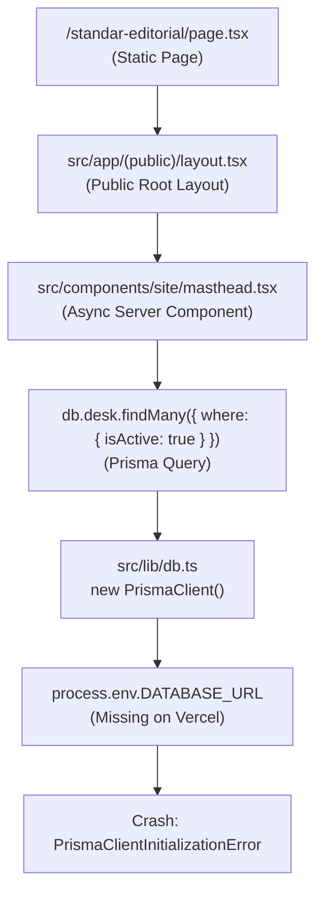

# Verax Press — Production Database Readiness & Architecture Evaluation
**Target System:** Verax Press (Next.js 16.1.1, React 19, Prisma ORM 6.19.2, Vercel Serverless)  
**Host/Platform:** Vercel Production (`arya-rizkys-projects/verax-press`)  
**Date:** 2026-11-10  
**Status:** Audit & Architecture Evaluation Completed — Awaiting Architecture Selection  

---

## 1. Executive Summary & Root Cause Analysis

### 1.1 The Build Failure Symptom
During the latest Vercel deployment of Verax Press, the build progressed through:
- Dependency installation (`bun install` / `npm install`) — **SUCCESS**
- Prisma Client generation (`prisma generate`) — **SUCCESS**
- Next.js compilation & TypeScript validation (`tsc --noEmit`) — **SUCCESS**

The build subsequently crashed during **Static Site Generation (SSG)** on route:
```text
Generating static pages (0/24) ...
Error occurred prerendering page "/standar-editorial". Read more: https://nextjs.org/docs/messages/prerender-error
PrismaClientInitializationError: 
Invalid `prisma.desk.findMany()` invocation:
Environment variable not found: DATABASE_URL.
  at /vercel/path0/.next/server/chunks/xxx.js
```

### 1.2 Root Cause Investigation
A trace of the page dependency graph reveals why `/standar-editorial` triggered this error despite containing purely static editorial copy:



1. **Root Layout Server Component Execution:**  
   `src/app/(public)/standar-editorial/page.tsx` is wrapped by `src/app/(public)/layout.tsx`. The layout renders `<Masthead />` ([`masthead.tsx`](file:///d:/Projects/verax/src/components/site/masthead.tsx#L12-L17)), which queries `db.desk.findMany()` to dynamically populate the primary navigation links with active editorial desks (`hukum-keadilan`, `teknologi-kebijakan`, `nasional-publik`).
2. **Build-Time Prerendering (SSG):**  
   Because `/standar-editorial` does not use dynamic hooks (`cookies()`, `headers()`, or `searchParams`), Next.js attempts to prerender it to static HTML at build time. Prerendering executes all Server Components in its layout tree, triggering `db.desk.findMany()`.
3. **Missing Environment Variable:**  
   Vercel currently has no `DATABASE_URL` configured in its environment variables (`vercel env ls` shows only `NEXTAUTH_SECRET`, `VERAX_MEDIA_API_URL`, and `VERAX_MEDIA_SECRET`).
4. **The Deeper Architectural Problem:**  
   The current repository uses `provider = "sqlite"` with a local database file (`DATABASE_URL="file:../db/custom.db"`). Even if `DATABASE_URL="file:../db/custom.db"` were set on Vercel:
   - In Vercel serverless functions, the root file system is **read-only** (`EROFS`).
   - Serverless Lambdas are ephemeral and stateless; writes to a local file are destroyed when instances spin down.
   - Concurrent serverless function invocations on a shared SQLite file cause `SQLITE_BUSY` / `database is locked` concurrency errors.
   - **Conclusion:** A local SQLite file is strictly incompatible with production serverless deployment. Verax Press requires a persistent, centralized, serverless-compatible production database.

---

## 2. Existing Database Inventory & Data Preservation

A verified snapshot and complete inventory of the local SQLite database was performed prior to proposing any architectural changes.

### 2.1 File & Verification Metrics
- **Active Database File:** `D:\Projects\verax\db\custom.db`
- **File Size:** `348,160 bytes` (~340 KB)
- **Source SHA-256 Checksum:** `9e2431ac7f9d83a04007941774bcc0ff3efba6e77ac3756527b79c1b6b0b34af`
- **PRAGMA integrity_check:** `ok`
- **PRAGMA foreign_key_check:** `0 violations`
- **Git Tracking Status:** Tracked in Git repository (commit `9310e37`). `.gitignore` excludes `*.db-wal`, `*.db-shm`, and `db/backups/`.

### 2.2 Verified Backup
A verified physical backup was generated and validated:
- **Backup Path:** `D:\Projects\verax\db\backups\custom_backup_2026-11-10T11-28-09-870Z.db`
- **Backup SHA-256 Checksum:** `9e2431ac7f9d83a04007941774bcc0ff3efba6e77ac3756527b79c1b6b0b34af` (100% Match)

### 2.3 Table & Record Count Inventory (16 Application Tables, 97 Records Total)

| Table Name | Row Count | Primary Purpose | Foreign Key Dependencies |
|---|---:|---|---|
| **ApiClient** | 11 | API client credentials for internal content ingestion | None |
| **Article** | 17 | Core published articles and editorial drafts | `Desk`, `StaffUser`, `MediaAsset` |
| **ArticleContribution** | 0 | Structured contributor credit mappings | `Article`, `Person` |
| **ArticleVersion** | 0 | Revision history (risk-edit, copyedit, author) | `Article` |
| **AuditEvent** | 56 | Immutable audit trail for publishing actions | Polymorphic `targetType`/`targetId` |
| **Complaint** | 2 | Public complaints, right of reply, correction claims | `Article` |
| **Contributor** | 0 | External contributor accounts (Stage B) | None |
| **CorrectionRecord** | 0 | Public correction records | `Article`, `StaffUser` |
| **Desk** | 3 | Editorial desks (`hukum-keadilan`, `teknologi-kebijakan`, `nasional-publik`) | Referenced by `Article` |
| **EditorialReview** | 0 | Internal editorial review decisions and status transitions | `Article`, `StaffUser` |
| **MediaAsset** | 2 | Visual media metadata & persistent storage keys | `Article`, `StaffUser` |
| **Person** | 5 | Public byline entities (separated from login accounts) | `StaffUser`, `Contributor` |
| **ReviewComment** | 0 | Editorial review comments (authorVisible flag) | `Article`, `StaffUser` |
| **SourceReference** | 0 | Source references and human verification statuses | `Article`, `StaffUser` |
| **StaffUser** | 4 | Editorial staff accounts (Chief, Editor, Author, Volunteer) | Referenced across system |
| **Submission** | 0 | Ingestion intake queue and idempotency records | `Article`, `Contributor` |

### 2.4 Index Inventory (26 Custom Indexes)
The database contains 26 active indexes covering uniqueness (`Article_slug_key`, `Desk_slug_key`, `StaffUser_email_key`, `Complaint_refCode_key`, `ApiClient_clientId_key`, `Submission_idempotencyKey_key`), multi-column compound queries (`Article_status_publishedAt_idx`, `Article_deskId_status_idx`, `Article_format_status_idx`, `Submission_origin_status_idx`), and foreign key lookup indexes (`AuditEvent_targetType_targetId_idx`, `SourceReference_articleId_idx`, etc.).

---

## 3. Database Dependencies Across Verax Press

The database is accessed across three distinct tiers of the application:

```
┌────────────────────────────────────────────────────────────────────────┐
│                        VERAX PRESS APPLICATION                         │
├──────────────────────────┬───────────────────────┬─────────────────────┤
│ 1. Public Web Tier       │ 2. Studio / CMS Tier  │ 3. API & Auth Tier  │
├──────────────────────────┼───────────────────────┼─────────────────────┤
│ - Masthead (Desks)       │ - Article Editor      │ - NextAuth Adapter  │
│ - Homepage (Articles)    │ - Workflow Machine    │ - Ingestion API     │
│ - Desk Archive           │ - Risk-Edit History   │ - Media Upload Sync │
│ - Article Detail (Hero)  │ - Media Library       │ - Complaint Intake  │
│ - Opinion Index          │ - Audit Trail Viewer  │ - API Key Verify    │
│ - Public Correction Log  │ - API Client Manager  │ - Audit Logging     │
│ - Author Byline Profile  │ - Complaint Review    │                     │
└──────────────────────────┴───────────────────────┴─────────────────────┘
```

1. **Public Web Tier (Read-Heavy, SSG & SSR):**
   - [`src/components/site/masthead.tsx`](file:///d:/Projects/verax/src/components/site/masthead.tsx): `db.desk.findMany()` (Navigation on all public pages).
   - `src/app/(public)/page.tsx`: `db.article.findMany()`, `db.desk.findMany()`, `db.correctionRecord.findFirst()`.
   - `src/app/(public)/desk/[slug]/page.tsx`: `db.desk.findUnique()`, `db.article.findMany()`.
   - `src/app/(public)/artikel/[slug]/page.tsx`: `db.article.findUnique()`, `db.sourceReference.findMany()`, `db.articleContribution.findMany()`.
   - `src/app/(public)/koreksi/page.tsx`: `db.correctionRecord.findMany()`.
   - `src/app/(public)/opini/page.tsx`: `db.article.findMany({ where: { format: 'OPINION' } })`.
   - `src/app/(public)/penulis/[id]/page.tsx`: `db.person.findUnique()`, `db.article.findMany()`.

2. **Studio / CMS Tier (Read/Write, Interactive):**
   - Articles management (`/studio/articles`): filtering by desk, status, author.
   - Article editor (`/studio/articles/[id]`): block-JSON loading, version drafting, risk-edit reason logging.
   - Editorial workflow: review transitions (`DRAFT` -> `PENDING_REVIEW` -> `FACT_CHECK` -> `PUBLISHED`).
   - Audit trail viewer (`/studio/audit`): paginated query of `AuditEvent`.
   - Media Library (`/studio/media`): query and attach `MediaAsset`.

3. **API & Ingestion Tier (Transactional Writes):**
   - NextAuth credential validation (`StaffUser` password hash and last login timestamp).
   - Ingestion API (`/api/v1/content/submit`): creates `Article`, `ArticleVersion`, `Submission`, and `AuditEvent` within an atomic `$transaction`.
   - Media Studio API (`/api/studio/media`): creates `MediaAsset` records synchronized with Azure VM storage.
   - Complaints API (`/api/complaints`): generates unique `refCode` and logs incoming requests.

---

## 4. Evaluation of Production Database Architectures

Three potential production architectures were evaluated against the project's requirements:

```
┌───────────────────────────┬───────────────────────────┬───────────────────────────┐
│        APPROACH A         │        APPROACH B         │        APPROACH C         │
│      libSQL / Turso       │ Managed Serverless Postgres│   Azure VM Hosted DB     │
│  (@prisma/adapter-libsql) │       (Neon Postgres)     │  (sqld / Postgres on VM)  │
└───────────────────────────┴───────────────────────────┴───────────────────────────┘
```

### Approach A: Remote SQLite-Compatible Database via libSQL / Turso

- **How it works:**  
  Uses Turso (managed libSQL) with Prisma ORM 6.19.2 driver adapters (`@prisma/adapter-libsql` and `@libsql/client`).
- **Prisma Schema Compatibility:**  
  Maintains `provider = "sqlite"`. Requires adding `previewFeatures = ["driverAdapters"]` to `generator client`. All 16 models remain structurally unchanged.
- **Client Initialization:**  
  Requires wrapping `@libsql/client` with `new PrismaLibSQL(libsql)` in `src/lib/db.ts`.
- **Data Migration Effort:**  
  Minimal. Turso can directly import the local `custom.db` file using `turso db create verax-press --from-file ./db/custom.db`.
- **Transactions:**  
  Interactive transactions (`$transaction`) are supported via libSQL's transactional pipeline over HTTP, but operate with an HTTP roundtrip timeout (5-second default).
- **Vercel Connection Behavior:**  
  Stateless HTTP requests (`libsql://...` or `https://...`). Zero TCP connection pooling issues in serverless.
- **Critical Limitation (CLI Migrations in Prisma 6):**  
  **The Prisma 6 CLI Rust engine does NOT support driver adapters.** Commands like `prisma migrate dev` and `prisma db push` strictly reject `libsql://` or `http://` URLs with:
  ```text
  Error: The database URL must start with the protocol 'file:'
  ```
  Schema updates on Turso cannot be applied directly via standard `prisma db push` in CI/CD; they require the separate Turso CLI, running a local shadow database, or custom migration scripts.
- **Cost / Free Tier (Official 2026 Turso Docs):**  
  - Starter Plan: Free ($0/month).
  - Storage: Up to 9 GB across 500 databases.
  - Usage: 1 billion row reads/month, 25 million row writes/month.
  - Scale: Generous limits for Verax Press.

---

### Approach B: Managed Serverless PostgreSQL (Neon PostgreSQL)

- **How it works:**  
  Connects Prisma to a managed PostgreSQL cluster with native connection pooling (`-pooler.neon.tech`).
- **Alignment with Project Baseline:**  
  **100% aligned.** The Technical Architecture baseline ([`03_Verity_Technical_Architecture_V1.1.md`](file:///d:/Projects/verax/docs/baseline/03_Verity_Technical_Architecture_V1.1.md#L43)) explicitly mandates:
  > *"| Database | PostgreSQL | Direkomendasikan untuk relasi artikel, versi, kontribusi, sumber, review, dan audit. |"*
  
  Furthermore, `worklog.md` (§2, ADR-002) states:
  > *"Keputusan: SQLite untuk dev/MVP; schema ditulis portabel (tanpa tipe spesifik-SQLite, tanpa enum — supaya migrasi ke PostgreSQL mulus saat keluar sandbox)... Item ini perlu keputusan founder saat deployment produksi."*
- **Prisma Schema Compatibility:**  
  Change `provider = "sqlite"` to `provider = "postgresql"` in `prisma/schema.prisma`. All 16 models were deliberately authored using portable types (`String`, `DateTime`, `Boolean`, `Int`) without SQLite-specific idioms.
- **Prisma CLI & Migration Workflow:**  
  **Flawless, first-class native support.** `prisma db push`, `prisma migrate dev`, and `prisma migrate deploy` work natively out of the box with `DATABASE_URL="postgresql://..."`. Zero preview features or CLI workarounds required.
- **Client Initialization:**  
  Standard `new PrismaClient()` in `src/lib/db.ts`. No experimental driver adapters needed.
- **Data Migration Effort:**  
  Low. The local SQLite database contains only 97 records across 16 tables. A deterministic migration script can transfer all rows from SQLite to PostgreSQL in seconds with complete relational integrity.
- **Vercel Connection Behavior:**  
  Neon provides a built-in PgBouncer connection pooler on port 5432 (`-pooler.neon.tech`). Thousands of concurrent Vercel serverless lambdas connect cleanly without exhausting database connection limits.
- **Transactions & Security:**  
  Full ACID transactions with true row-level locks, SCRAM-SHA-256 password authentication, enforced TLS (`sslmode=require`).
- **Backup & Recovery:**  
  Continuous automated backups, point-in-time recovery (PITR), and instant copy-on-write branching (allowing isolated database branches for Vercel Preview deployments).
- **Cost / Free Tier (Official 2026 Neon Docs):**  
  - Free Plan: $0/month.
  - Storage: 0.5 GB (Verax database is ~0.35 MB, utilizing < 0.1% of quota).
  - Compute: 100 compute hours / month with automatic scale-to-zero after 5 minutes of inactivity.
  - Connection pooling included at no charge.
- **Existing User Asset:**  
  The user already has an active, authenticated Neon account (`org-billowing-flower-40925193`) with compute located in `aws-ap-southeast-1` (Singapore), providing minimal latency to users in Southeast Asia.

---

### Approach C: Host Database on Azure VM (`forfh-korea-vm`)

- **How it works:**  
  Run either PostgreSQL, libSQL server (`sqld`), or an application-level data API directly on the existing Korea Central VM (`20.214.143.187`).
- **Memory & Resource Risk:**  
  **Severe Risk.** The VM is an entry-level `Standard_B2ats_v2` with only **892 MiB total RAM**.
  - Current memory utilization is already at **66.3%** running 6 active services (`forfh`, `kontrakpaham`, `webhook`, `rivals-evidence`, `vpn-api`, `verax-media`).
  - Adding a database server daemon (PostgreSQL requires 100–250 MiB resident memory) would push total RAM utilization past 90%, triggering Linux OOM-killer invocations that would crash production services.
- **Network Latency Waterfall:**  
  Vercel serverless functions default to `iad1` (US East) or global edge, while the VM is in `koreacentral`. Each database query would incur 150–200ms latency. A single page executing 4 queries in sequence would take 800ms+ just in network transport overhead.
- **Operational Complexity:**  
  Requires managing firewall rules (opening port 5432), SSL certificates, database crash recovery, disk backup schedules, and monitoring on an already constrained VM.
- **Application API Approach:**  
  Wrapping the SQLite database in an HTTP API on the VM would require rewriting all Prisma queries across dozens of files in Verax Press, abandoning type-safe Prisma models and transaction semantics.
- **Conclusion:** Approach C is strongly discouraged due to hardware constraints and latency.

---

## 5. Architectural Comparison Matrix

| Evaluation Vector | Approach A: libSQL / Turso | Approach B: Managed PostgreSQL (Neon) | Approach C: Azure VM Hosted DB |
|---|---|---|---|
| **Technical Baseline Alignment** | Diverges from baseline | **100% Matches Technical Architecture Baseline (§3)** | Diverges from baseline |
| **Prisma 6 Compatibility** | Requires `previewFeatures = ["driverAdapters"]` | **Native first-class Prisma Client** (Stable) | Native (Postgres) or Custom API |
| **Prisma CLI Migrations (`db push` / `migrate`)** | **Broken** (Prisma CLI requires `file:`) | **Native & Seamless** (`prisma db push` works) | Native (if port opened) |
| **Vercel Build Integration** | Requires build script workarounds | **Standard Vercel Prisma integration** | High build latency |
| **Connection Pooling** | HTTP stateless | **Built-in PgBouncer pooler** (`-pooler`) | Requires manual PgBouncer |
| **Serverless Cold Starts** | Very fast (~50-100ms) | Fast with pooler (~150-300ms) | High (~300-600ms) |
| **Cross-Region Latency** | Low (Edge replicas) | **Very Low** (`aws-ap-southeast-1` Singapore) | High (~150-200ms roundtrip) |
| **Azure VM Resource Impact** | **Zero impact** on VM | **Zero impact** on VM | **High OOM Risk** (892MB RAM) |
| **Data Migration Complexity** | Direct SQLite file upload | Transfer 97 rows via type-safe script | Direct file copy |
| **Transaction Reliability** | HTTP pipeline (5s timeout) | **True ACID row/table locks** | True ACID (Postgres) |
| **Backup & Recovery** | Automated snapshot | **Point-in-time recovery & Branching** | Manual VM script |
| **Monthly Cost** | Free ($0) | **Free ($0)** | Free ($0, but high risk) |

---

## 6. Detailed Evaluation of libSQL / Turso Specifics (Section 3 Audit)

Per the specific audit instructions for Prisma 6.19.2 and libSQL:

1. **Packages Required:**  
   `@prisma/adapter-libsql@6.19.2` and `@libsql/client@^0.14.0` (must match `@prisma/client@6.19.2`).
2. **Prisma Schema Configuration:**
   ```prisma
   generator client {
     provider        = "prisma-client-js"
     previewFeatures = ["driverAdapters"]
   }
   datasource db {
     provider = "sqlite"
     url      = env("DATABASE_URL")
   }
   ```
3. **Runtime Client Initialization (`src/lib/db.ts`):**
   ```typescript
   import { createClient } from '@libsql/client';
   import { PrismaLibSQL } from '@prisma/adapter-libsql';
   import { PrismaClient } from '@prisma/client';

   const url = process.env.DATABASE_URL!;
   const authToken = process.env.TURSO_AUTH_TOKEN;

   const isLibsql = url.startsWith('libsql://') || url.startsWith('https://');
   const adapter = isLibsql ? new PrismaLibSQL(createClient({ url, authToken })) : undefined;

   export const db = new PrismaClient(adapter ? { adapter } : { log: ['query'] });
   ```
4. **The Critical Blocker in CI/CD:**  
   When Vercel runs `prisma generate && next build`, if a deployment workflow attempts to run `prisma db push`, the Prisma CLI Rust query engine rejects `DATABASE_URL=libsql://...`. This creates an operational friction point where schema changes must be pushed out-of-band via Turso CLI rather than standard Prisma commands.
5. **Data Representation:**  
   Dates are stored as numeric milliseconds or ISO strings. While compatible with SQLite, libSQL lacks PostgreSQL's native `TIMESTAMPTZ` with timezone arithmetic.

---

## 7. Deep-Dive: Static Generation vs. Dynamic Rendering

### 7.1 Why Masthead Queries the Database
In `src/components/site/masthead.tsx`:
```typescript
export async function Masthead() {
  const desks = await db.desk.findMany({
    where: { isActive: true },
    orderBy: { sortOrder: "asc" },
    select: { slug: true, name: true },
  });
```
Editorial desks rarely change (typically 3–5 categories). However, Verax Press modeled desks as a dynamic database entity (`model Desk`) so editors can manage or reorder categories.

### 7.2 Defensive Hardening Without Hiding Errors
Per global principles, we must **never** use `export const dynamic = 'force-dynamic'` merely to hide a missing database connection.

However, in production Next.js architectures, it is best practice for root layout navigation components to implement **resilient build-time caching**:
- Use Next.js `unstable_cache` with a cache tag (`['editorial-desks']`) and revalidation (`revalidate: 3600`).
- If an ephemeral database network hiccup occurs during a static page build, provide a fallback to the baseline editorial desks defined in the platform charter:
  - `hukum-keadilan` ("Hukum & Keadilan")
  - `teknologi-kebijakan` ("Teknologi & Kebijakan")
  - `nasional-publik` ("Nasional & Kebijakan Publik")
- **Crucial Distinction:** This resilience ensures static documentation pages like `/standar-editorial` do not crash if the database connection has a transient cold-start delay, but it does **not** bypass the requirement for a real, persistent production database for all dynamic routes.

---

## 8. Strategic Recommendation & Migration Plan

### 8.1 Primary Recommendation: Managed Serverless PostgreSQL (Neon)
**Approach B (Managed Serverless PostgreSQL)** is the strongly recommended architecture:
1. **Fulfills the Original Blueprint:** Directly satisfies Technical Architecture Baseline §3 and ADR-002.
2. **Prisma 6 Stability:** Native, first-class support in Prisma 6.19.2 without driver adapters, preview flags, or CLI limitations.
3. **Zero VM Overhead:** Completely offloads database processing from the RAM-constrained Azure VM (892MB).
4. **Low Latency:** User's Neon account is in `aws-ap-southeast-1` (Singapore), ensuring single-digit millisecond latency to Southeast Asian traffic and optimal Vercel Edge performance.
5. **Zero Additional Cost:** Completely within the existing free tier.

### 8.2 Secondary Alternative: Turso / libSQL
If the team strictly mandates retaining `provider = "sqlite"` with zero Prisma schema changes, **Approach A (Turso)** is viable, provided the team accepts that schema migrations cannot be executed via `prisma db push` on Vercel and must be managed via Turso CLI.

---

## 9. End-to-End Migration & Verification Plan (for Approach B)

### Step 1: Pre-Migration Data Safety (COMPLETED)
- Verified physical backup created at `db/backups/custom_backup_2026-11-10T11-28-09-870Z.db`.
- SHA-256 fingerprint verified (`9e2431ac...`).
- Full inventory of all 97 rows and 16 tables documented.

### Step 2: Target Database Provisioning (Requires User Confirmation)
- In the user's Neon account (`org-billowing-flower-40925193` in `aws-ap-southeast-1`), create a dedicated database `verax_press` (or a dedicated project).
- Retrieve the pooled connection string:
  ```env
  DATABASE_URL="postgresql://[user]:[password]@[host]-pooler.ap-southeast-1.aws.neon.tech/verax_press?sslmode=require"
  DIRECT_URL="postgresql://[user]:[password]@[host].ap-southeast-1.aws.neon.tech/verax_press?sslmode=require"
  ```

### Step 3: Schema Adaptation
Update `prisma/schema.prisma`:
```prisma
datasource db {
  provider  = "postgresql"
  url       = env("DATABASE_URL")
  directUrl = env("DIRECT_URL")
}
```
Run schema creation:
```bash
bunx prisma db push
```

### Step 4: Type-Safe Data Transfer Script
Execute a dedicated migration script `scripts/migrate-sqlite-to-postgres.ts`:
1. Connects to `db/custom.db` via `node:sqlite` (read-only).
2. Connects to PostgreSQL via Prisma Client.
3. Inserts records in strict dependency order:
   `StaffUser` -> `Contributor` -> `Person` -> `Desk` -> `MediaAsset` -> `Article` -> `ArticleVersion` -> `ArticleContribution` -> `SourceReference` -> `EditorialReview` -> `ReviewComment` -> `Submission` -> `ApiClient` -> `Complaint` -> `CorrectionRecord` -> `AuditEvent`.
4. Validates exact row counts for all 16 tables.

### Step 5: Vercel Environment Configuration
Inject credentials securely using Vercel CLI without logging raw secrets:
```bash
# Add DATABASE_URL to Production and Preview scopes
vercel env add DATABASE_URL production,preview
vercel env add DIRECT_URL production,preview
```

### Step 6: Full Verification Suite
1. Run `bunx prisma generate`.
2. Run `bun run typecheck`.
3. Run `bun run build` locally to verify static page generation (`/standar-editorial`, `/`, `/koreksi`, `/tentang`).
4. Execute `services/media-storage/tests/test-cms-suite.ts` to verify Prisma write operations and hero image associations.
5. Deploy to Vercel production: `vercel --prod`.
6. Verify live deployment at `https://verax-press.vercel.app/standar-editorial`.

### Step 7: Rollback Procedure
If any unexpected defect arises:
1. Revert `prisma/schema.prisma` datasource back to `sqlite`.
2. Re-run `bunx prisma generate`.
3. The verified SQLite backup (`custom_backup_2026-11-10T11-28-09-870Z.db`) remains completely untouched and immediately restorable.

---

## 10. Required User Actions & Next Steps

Per execution boundary guidelines, **no production database provisioning or destructive schema changes have been performed**.

To proceed with resolving the Vercel build failure, please select your preferred architectural path:

1. **Option B (Recommended — Managed PostgreSQL via Neon):**  
   - Leverages your existing Neon account in Singapore (`aws-ap-southeast-1`).
   - 100% aligns with the Technical Architecture Baseline.
   - Provides native connection pooling and clean Prisma CLI migrations.
2. **Option A (Alternative — Turso / libSQL):**  
   - Retains SQLite provider with `@prisma/adapter-libsql`.
   - Requires setting up a Turso database and managing migrations out-of-band.

Upon your selection, the migration will be executed using the verified backup and data transfer pipeline.
