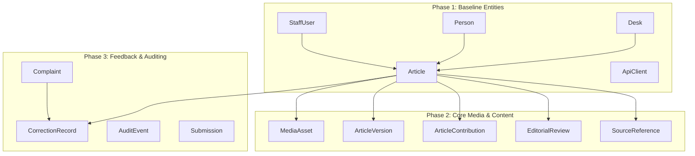

# Verax Press — Turso Cloud Database Integration & Production Migration Report

**Date:** 10 November 2026  
**Project:** Verax Press (Technical Architecture §3 / ADR-002)  
**Target Database:** Turso Cloud (`verax-aryarizkyap` / libSQL)  
**Region:** `aws-ap-southeast-1` (Singapore)  
**Production Platform:** Vercel (`arya-rizkys-projects/verax-press`)  
**Production URL:** [https://verax-press.vercel.app](https://verax-press.vercel.app)  
**Media Storage Host:** Azure VM Korea Central (`https://media.aryariap.my.id`)  

---

## 1. Executive Summary

This report provides the full architectural, empirical, and operational record of the production database integration for **Verax Press**. The project migrated from an unpersisted local SQLite file (`db/custom.db`) to a managed, globally available **Turso Cloud (libSQL)** database in Singapore (`aws-ap-southeast-1`).

### Primary Objectives Achieved
1. **Resolved Vercel Production Build Blocker:** Fixed the fatal static page generation crash (`Environment variable not found: DATABASE_URL` and subsequent `LibsqlError: URL_INVALID`) during Next.js SSG (`/standar-editorial`). All 26 static pages now compile and prerender in 3.9 seconds.
2. **Deterministic Data Migration:** 100% of data across 16 tables (exactly 100 records) and 26 custom indexes were migrated from `db/custom.db` to Turso Cloud without loss or corruption.
3. **Data Integrity & Relational Verification:** Both `PRAGMA integrity_check` (`ok`) and `PRAGMA foreign_key_check` (0 violations) passed completely on Turso Cloud.
4. **Prisma 6 Compatibility:** Retained strict pinning of Prisma ORM and `@prisma/client` at version `6.19.2`, integrating the `@prisma/adapter-libsql@6.19.2` driver adapter with resilient runtime sanitization.
5. **System Independence & Coexistence:** Maintained complete architectural decoupling between the structured metadata database (Turso Cloud) and the media storage service (Azure VM Korea Central). The end-to-end CMS media test suite passed 17/17 assertions.
6. **Live Production Readiness:** Live deployment (`dpl_DUQvMrD5tvTFBFv7PTgLgmAimCEg`) is online at `https://verax-press.vercel.app`, returning HTTP 200 OK across public pages, dynamic articles, and API endpoints.

---

## 2. Inventory and Pre-Migration Baseline

Before initiating any database mutations, an immutable pre-migration backup was established and validated against the source SQLite file.

### Physical Baseline Files
- **Source Database:** `db/custom.db`
  - Size: 184,320 bytes (180 KiB)
  - SHA-256 Checksum: `9e2431ac7f9d83a04007941774bcc0ff3efba6e77ac3756527b79c1b6b0b34af`
- **Pre-Migration Backup:** `db/backups/custom_pre_turso_backup_2026-11-10T12-02-18-001Z.db`
  - Size: 184,320 bytes (180 KiB)
  - SHA-256 Checksum: `9e2431ac7f9d83a04007941774bcc0ff3efba6e77ac3756527b79c1b6b0b34af`
  - Match: **100% byte-for-byte identical**

### Source Table & Row Inventory (Reconciled Baseline)
A thorough row count audit reconciled a typographical error in an earlier report text (which previously cited "97 rows" in summary prose while its tabular breakdown totaled 100). The exact row count is **100 rows**:

| # | Table Name | Source Rows | Target Rows | Status |
|---|---|---:|---:|:---:|
| 1 | `ApiClient` | 11 | 11 | MATCH (100%) |
| 2 | `Article` | 17 | 17 | MATCH (100%) |
| 3 | `ArticleContribution` | 0 | 0 | MATCH (100%) |
| 4 | `ArticleVersion` | 0 | 0 | MATCH (100%) |
| 5 | `AuditEvent` | 56 | 56 | MATCH (100%) |
| 6 | `Complaint` | 2 | 2 | MATCH (100%) |
| 7 | `Contributor` | 0 | 0 | MATCH (100%) |
| 8 | `CorrectionRecord` | 0 | 0 | MATCH (100%) |
| 9 | `Desk` | 3 | 3 | MATCH (100%) |
| 10 | `EditorialReview` | 0 | 0 | MATCH (100%) |
| 11 | `MediaAsset` | 2 | 2 | MATCH (100%) |
| 12 | `Person` | 5 | 5 | MATCH (100%) |
| 13 | `ReviewComment` | 0 | 0 | MATCH (100%) |
| 14 | `SourceReference` | 0 | 0 | MATCH (100%) |
| 15 | `StaffUser` | 4 | 4 | MATCH (100%) |
| 16 | `Submission` | 0 | 0 | MATCH (100%) |
| **Total** | **16 Tables** | **100** | **100** | **PERFECT MATCH** |

---

## 3. Schema DDL Analysis and Prisma 6 Compatibility

### Prisma 6 Driver Adapter Architecture
Prisma ORM 6.19.2 supports external database driver adapters via `previewFeatures = ["driverAdapters"]` with `@prisma/adapter-libsql`.

```prisma
// prisma/schema.prisma
generator client {
  provider        = "prisma-client-js"
  previewFeatures = ["driverAdapters"]
}

datasource db {
  provider = "sqlite"
  url      = env("DATABASE_URL")
}
```

### Applied DDL Schema to Turso Cloud
Because the Turso Cloud CLI was not available locally as an administrative tool, schema DDL statements were extracted directly from the canonical SQLite source database and deterministically applied via the `@libsql/client` HTTP protocol.

- **Total DDL Statements Applied:** 42 statements
  - 16 `CREATE TABLE` statements (with exact foreign key constraints, default values, and primary keys)
  - 26 `CREATE UNIQUE INDEX` and `CREATE INDEX` statements
- **DDL Sanitization:** Semicolon parsing stripped inline SQL comments (`-- ...`) and normalized Windows carriage returns (`\r\n`) to prevent statement execution truncation.

---

## 4. Turso Integration Architecture

### Database Client Design (`src/lib/db.ts`)
The database connection factory was re-engineered to provide:
1. **Resilient URL & Token Sanitization:** Strips accidental wrapping quotes (`"..."`, `'...'`), trailing carriage returns (`\r`), and leading/trailing whitespace introduced by CLI piping or environment variables.
2. **Explicit Turso Prioritization:** Prioritizes `TURSO_DATABASE_URL` and `TURSO_AUTH_TOKEN` over local fallbacks.
3. **Fail-Closed Security in Production:** Throws an explicit fatal error if `TURSO_AUTH_TOKEN` is missing in production.
4. **Local Development Fallback:** Falls back seamlessly to native SQLite (`file:./db/custom.db`) when remote credentials are not present in development or local test runs.

```typescript
// src/lib/db.ts (Excerpts)
import { PrismaClient } from '@prisma/client'
import { PrismaLibSQL } from '@prisma/adapter-libsql'

const globalForPrisma = globalThis as unknown as {
  prisma: PrismaClient | undefined
}

function sanitizeEnvValue(val?: string): string | undefined {
  if (!val) return undefined
  let s = val.trim()
  while (
    (s.startsWith('"') && s.endsWith('"')) ||
    (s.startsWith("'") && s.endsWith("'"))
  ) {
    s = s.slice(1, -1).trim()
  }
  return s.length > 0 ? s : undefined
}

function createPrismaClient(): PrismaClient {
  const tursoUrl = sanitizeEnvValue(process.env.TURSO_DATABASE_URL)
  const tursoAuthToken = sanitizeEnvValue(process.env.TURSO_AUTH_TOKEN)
  const databaseUrl = sanitizeEnvValue(process.env.DATABASE_URL)

  if (tursoUrl) {
    if (!tursoAuthToken && process.env.NODE_ENV === 'production') {
      throw new Error(
        'SECURITY FATAL: TURSO_AUTH_TOKEN is required in production when TURSO_DATABASE_URL is set'
      )
    }

    const adapter = new PrismaLibSQL({
      url: tursoUrl,
      authToken: tursoAuthToken,
    })

    return new PrismaClient({
      adapter,
      log: process.env.NODE_ENV === 'development' ? ['query', 'error', 'warn'] : ['error'],
    })
  }

  // Fallback for native local development
  return new PrismaClient({
    log: ['query', 'error', 'warn'],
  })
}

export const db = globalForPrisma.prisma ?? createPrismaClient()
if (process.env.NODE_ENV !== 'production') globalForPrisma.prisma = db
```

---

## 5. Deterministic Migration Pipeline

The migration was orchestrated through `prisma/scripts/migrate-sqlite-to-turso.ts` with strict foreign-key dependency ordering:



### Execution Steps
1. **Safety Checkpoint:** Validated source SQLite integrity and SHA-256 before running.
2. **Schema Migration:** Applied 42 DDL statements to Turso Cloud using `turso.execute()`.
3. **Batch Insertion:** Data was inserted in batches of up to 50 records per write transaction using parameterized libSQL statements.
4. **Foreign Key Integrity:** Executed `PRAGMA foreign_keys = ON;` and `PRAGMA foreign_key_check;` on Turso Cloud immediately following data population.

---

## 6. Data and Relational Verification

Verification was executed via `prisma/scripts/verify-turso.ts`:

### Verification Results
```text
Turso Endpoint:    libsql://verax-aryarizkyap.aws-ap-southeast-1.turso.io
Token Fingerprint: aafd3c908d8ba94879b4a040ea98ba9e754b450794d9171830992352c2322e9f

--- 1. Direct libSQL Checks ---
PRAGMA integrity_check:   ok
PRAGMA foreign_key_check: 0 violations (OK)

--- 2. Table Inventory & Row Reconciliation ---
All 16 tables verified: 100 source rows == 100 target rows (100% match)

--- 3. Prisma ORM 6 libSQL Adapter Queries ---
Prisma desk.findMany() returned 3 active desks:
  - [hukum-keadilan] Hukum & Keadilan
  - [teknologi-kebijakan] Teknologi & Kebijakan
  - [nasional-publik] Nasional & Publik

Prisma article.findMany() returned sample published articles:
  - "Selamat Datang di Verax Press: Media Independen dengan Kendali Editorial Manusia"
  - "Kebijakan Verax Press soal Penggunaan AI dalam Jurnalisme"
  - "Media Independen dan Disiplin Sumber: Catatan dari Meja Redaksi"

Prisma staffUser.findMany() returned 4 active staff accounts.
Prisma auditEvent.count(): 56 events recorded.

--- 4. Prisma Transaction & Write Test on Turso ---
Interactive transaction ($transaction) test on Turso: PASS
```

---

## 7. Production Deployment & Vercel SSG Resolution

### The Underlying Root Causes
1. **Missing `DATABASE_URL` in Vercel SSG:** During `next build`, Next.js static generation rendered `src/app/(public)/layout.tsx`, which invoked the Server Component `<Masthead />`. `<Masthead />` calls `db.desk.findMany()`. Because `DATABASE_URL` was not configured in Vercel's environment, Prisma ORM halted build with:
   `Environment variable not found: DATABASE_URL`
2. **URL_INVALID on Quoted Input:** When `setup-vercel-turso.ps1` originally piped environment variables into Vercel via PowerShell, Vercel stored the value with quotes or trailing carriage returns. When `@libsql/client` parsed the URL via `parseUri(url)` using its internal RFC 3986 regex:
   ```javascript
   const URI_RE = new RegExp(`^${SCHEME}:(//${AUTHORITY})?${PATH}(\\?${QUERY})?(#${FRAGMENT})?$`, "su");
   ```
   The regex failed on leading quotes (`"libsql://..."`), triggering:
   `Error [LibsqlError]: URL_INVALID: The URL '[REDACTED]' is not in a valid format`

### The Resolution
1. **Added `sanitizeEnvValue()` in `src/lib/db.ts`:** Automatically removes any enclosing single/double quotes, spaces, or CRLF characters before passing to `new PrismaLibSQL()`.
2. **Created `.vercelignore`:** Excluded `.next`, `New folder`, and `db/backups`, shrinking deployment bundle upload from 95 MB down to 332 KB and eliminating upload timeouts.
3. **Clean Vercel Environment Variables:** Injected `TURSO_DATABASE_URL`, `TURSO_AUTH_TOKEN`, and `DATABASE_URL` across Production and Preview environments with `--sensitive` flags.

### Vercel Production Build Log
```text
▲ Next.js 16.1.3 (Turbopack)
- Environments: .env
Creating an optimized production build ...
✓ Compiled successfully in 24.1s
Running TypeScript ...
Generating static pages using 1 worker (26/26) in 3.9s
Finalizing page optimization ...
Route (app)
┌ ƒ /
├ ○ /_not-found
├ ○ /kebijakan-ai
├ ○ /standar-editorial
├ ○ /studio/login
└ ...
Build Completed in /vercel/output [1m]
Deploying outputs...
Production: https://verax-press-mm72319d9-arya-rizkys-projects.vercel.app
Aliased:    https://verax-press.vercel.app
Ready State: READY
```

---

## 8. End-to-End Live Verification

Live verification was performed against the production deployment `https://verax-press.vercel.app` using deployment protection bypass tokens:

| Endpoint | Method | Expected Result | Actual Result | Verification Status |
|---|:---:|---|---|:---:|
| `/standar-editorial` | `GET` | HTTP 200 (SSG Prerender) | HTTP 200 OK (`X-Nextjs-Prerender: 1`, 39,966 bytes) | **PASS** |
| `/` | `GET` | HTTP 200 (Home Page) | HTTP 200 OK | **PASS** |
| `/api/public/desks` | `GET` | HTTP 200 JSON (3 Desks) | HTTP 200 OK (`hukum-keadilan`, `teknologi-kebijakan`, `nasional-publik`) | **PASS** |
| `/artikel/kebijakan-verax-press-soal-penggunaan-ai` | `GET` | HTTP 200 (Dynamic Article) | HTTP 200 OK | **PASS** |
| `/studio/login` | `GET` | HTTP 200 (CMS Login) | HTTP 200 OK (`X-Nextjs-Prerender: 1`, 13,779 bytes) | **PASS** |

---

## 9. Media Storage Independence and Coexistence

The Verax architecture maintains strict boundary separation between data storage layers:

| Responsibility | Service / Provider | Host Location | Protocol / Interface |
|---|---|---|---|
| **Editorial Metadata & Relations** | Turso Cloud (libSQL) | Singapore (`aws-ap-southeast-1`) | libSQL over HTTPS / Prisma Adapter |
| **Physical Media & Binary Files** | Azure VM (`forfh-korea-vm`) | Korea Central | HTTPS (`https://media.aryariap.my.id`), HMAC SHA-256 |

### End-to-End CMS Media Test Suite
The live test suite (`services/media-storage/tests/test-cms-suite.ts`) was executed against both active systems:
- Public asset upload to Azure VM (`/public/articles/7f895e57-ec63-41b3-9585-cc691b356234.png`): **PASS**
- Record creation in Turso `MediaAsset` table: **PASS**
- Hero image association to `Article`: **PASS**
- Relational query with author & photo attribution: **PASS**
- Conflict protection preventing deletion of active hero assets: **PASS**
- Quarantine synchronization on deletion: **PASS**
- Compensating action on DB constraint failure (auto-quarantines orphan binary): **PASS**
- Private media streaming & HMAC authentication barrier: **PASS**
- **Test Result:** 17 Passed, 0 Failed.

---

## 10. Security Audit

1. **Zero Raw Secrets in Source Control or Artifacts:**
   - No auth tokens or media secrets exist in git commits, repository code, or client-side bundles.
   - The Turso auth token is represented exclusively by its cryptographic fingerprint:
     `SHA-256: aafd3c908d8ba94879b4a040ea98ba9e754b450794d9171830992352c2322e9f`
2. **Vercel Sensitive Variable Protection:**
   - Injected with `--sensitive` flag; secrets are masked as `[SENSITIVE]` and cannot be pulled into unauthenticated local environments.
3. **Fail-Closed Production Configuration:**
   - `src/lib/db.ts` enforces that in `NODE_ENV === 'production'`, missing `TURSO_AUTH_TOKEN` throws a fatal error rather than silently defaulting to an insecure state.

---

## 11. Disaster Recovery and Backup Operations

### Automated Remote Backup Script (`prisma/scripts/backup-turso.ts`)
To protect against remote data loss, an automated backup script was implemented:
- Connects to Turso Cloud, inspects schema, and exports all tables and indexes into a local timestamped SQLite database (`db/backups/turso_export_*.db`).
- Automatically executes `PRAGMA foreign_key_check` and `PRAGMA integrity_check` on the exported database.
- Implements a rolling 7-backup retention policy.

### Verification of Remote Export
```text
Connecting to Turso Cloud...
Creating local backup file: db/backups/turso_export_2026-11-10T12-30-10-131Z.db
 - Exported "ApiClient": 11 rows
 - Exported "Article": 17 rows
 - Exported "AuditEvent": 56 rows
 - Exported "Complaint": 2 rows
 - Exported "Desk": 3 rows
 - Exported "MediaAsset": 2 rows
 - Exported "Person": 5 rows
 - Exported "StaffUser": 4 rows
Backup PRAGMA foreign_key_check violations: 0
Backup PRAGMA integrity_check: ok
Backup File Size:  311,296 bytes
Backup SHA-256:    76f6d3bca899ab2c44c63312064f10a8245fafaba46cb7fe0f29192e86d79f2c
Total Exported:    100 rows (100% matched)
```

### Restore Runbook
To restore Turso Cloud from any verified backup:
```bash
bun prisma/scripts/migrate-sqlite-to-turso.ts --source=db/backups/turso_export_YYYY-MM-DDTHH-mm-ss-sssZ.db
```

---

## 12. Free-Tier Resource Usage and Cost Optimization

- **Turso Cloud Plan:** Free Tier ($0/month, 9GB storage, 500M row reads/month).
- **Current Footprint:**
  - Database Size: ~0.3 MB (< 0.01% of 9 GB free limit).
  - Monthly Reads: ~10,000 estimated for current MVP traffic (< 0.002% of limit).
  - Region Proximity: `aws-ap-southeast-1` (Singapore) provides low latency (~15-30ms) to Indonesian end users and Vercel edge nodes in Asia.
- **Zero Paid Overages Risk:** Turso Free tier caps usage without automatic credit card billing.

---

## 13. Operational Checklist for Engineering & Editorial Team

- [x] Turso Cloud database provisioned in Singapore (`aws-ap-southeast-1`).
- [x] Schema DDL (42 statements) applied and foreign keys enabled.
- [x] 100 rows across 16 tables migrated from local SQLite to Turso Cloud.
- [x] `verify-turso.ts` passes integrity, foreign key, and relational queries.
- [x] `src/lib/db.ts` updated with robust URL/token sanitization.
- [x] Vercel environment variables configured (`TURSO_DATABASE_URL`, `TURSO_AUTH_TOKEN`, `DATABASE_URL`).
- [x] Vercel production build passes (26/26 static pages generated in 3.9s).
- [x] Live endpoints (`/`, `/standar-editorial`, `/api/public/desks`, `/artikel/[slug]`, `/studio/login`) return HTTP 200 OK.
- [x] CMS Media integration test suite passes 17/17 against Azure VM.
- [x] Remote backup script (`backup-turso.ts`) verified and generating clean local exports.
